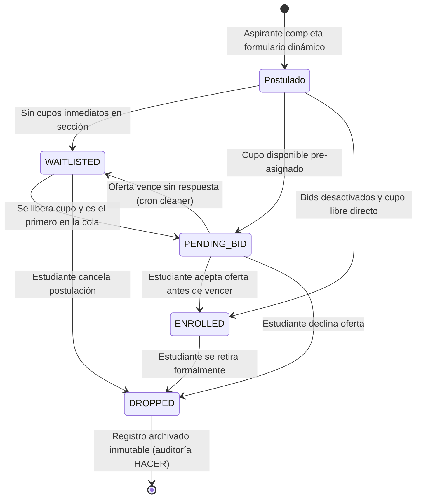
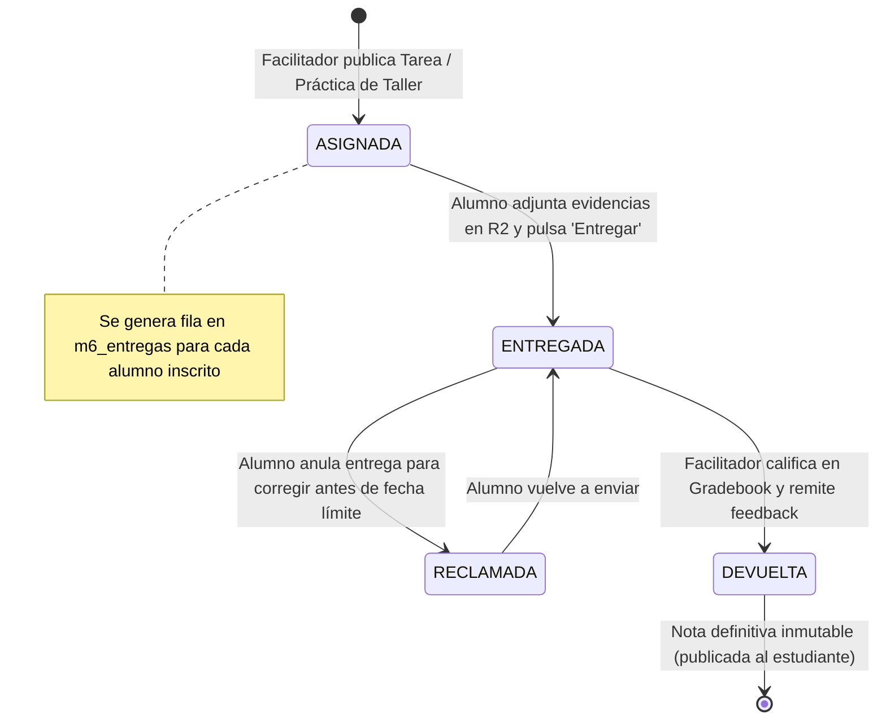
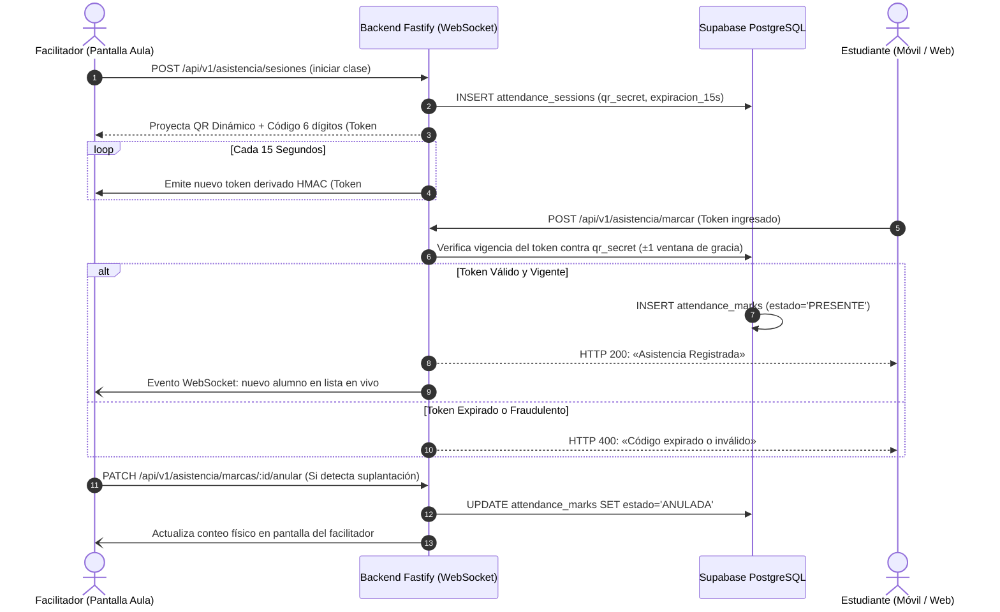

# ESPECIFICACIÓN MAESTRA DE SISTEMA Y DOSSIER DE ARQUITECTURA (SPEC-DRIVEN DEVELOPMENT)
## INCES LMS — Sistema de Gestión Académica y Campus Virtual
### Centro de Formación Socialista (CFS) Nacional de Soldadura «Rafael Urdaneta» (La Isabelica, Carabobo)

---

> **PROPÓSITO DE ESTE DOCUMENTO:**  
> Este documento técnico ha sido diseñado de manera exhaustiva y autocontenida bajo la metodología **Spec-Driven Development (SDD)** para transferir el 100% del contexto operativo, arquitectónico, pedagógico, estructural y de seguridad del proyecto a una **IA que actúa como Arquitecto de Software Principal / Lead System Architect**, sin requerir acceso directo al código fuente.  
> 
> **Versión del Sistema:** `v1.2.9` (Producción 2026)  
> **Árbol de Código:** 240 archivos Dart analizados (0 errores, 0 advertencias, 0 infos) · 705/705 pruebas unitarias/integración de backend aprobadas · 26/26 pruebas de frontend aprobadas.  
> **Estado de Despliegue:** Cloudflare Pages (`https://inces-lms.pages.dev`), Render API (`https://inces-lms-api.onrender.com`), Supabase Cloud (PostgreSQL 15 con RLS y GoTrue Auth), Cloudflare R2 Object Storage.

---

## 1. METADATOS Y CONTEXTO INSTITUCIONAL DEL PRODUCTO

### 1.1 Naturaleza y Contexto de Defensa
- **Proyecto:** INCES LMS.
- **Naturaleza:** Trabajo Especial de Grado (TEG) de Análisis de Sistemas (4.º semestre, IUTEPI, periodo SA26-2).
- **Autor / Product Owner:** Lorenzo Roca (`lorenzo-roca11@hotmail.com`).
- **Institución Destino:** CFS Nacional de Soldadura «Rafael Urdaneta» (INCES La Isabelica, Valencia, Estado Carabobo, Venezuela).
- **Plataforma Nacional:** El LMS **alimenta y complementa** a la plataforma institucional **HACER** (la plataforma nacional centralizada del INCES) a través de exportaciones normalizadas (CSV/Excel). **No la sustituye.**
- **Fronteras Delimitadas del Sistema (Decisiones de Diseño / ADRs innegociables):**
  1. **No emite títulos ni certificados oficiales:** El módulo M9 fue formalmente descartado del alcance porque la emisión de títulos en Venezuela está legalmente reservada a la plataforma nacional HACER y al Ministerio del Poder Popular para la Educación.
  2. **Verificación de Identidad Física:** La verificación legal de identidad se ejecuta de manera presencial en la sede con cédula de identidad laminada. El sistema no finge un proceso biométrico o KYC automatizado.
  3. **Presupuesto y Tolerancia a Fallos:** Diseñado para operar con **presupuesto de infraestructura \$0 (Zero-Cost Cloud)** mediante la explotación rigurosa de capas gratuitas robustas (Supabase Free, Cloudflare Pages Free, Cloudflare R2 Free 10GB, Render Web Service Free, GitHub Actions).
  4. **Condiciones de Despliegue en Venezuela:** Arquitectura dual (Cloud + Edge + Servidor local vía Docker Compose) con resiliencia ante cortes eléctricos y conectividad intermitente en talleres.

---

## 2. METODOLOGÍA SPEC-DRIVEN DEVELOPMENT (SDD) Y REGLAS DE DOMINIO

Bajo **Spec-Driven Development (SDD)**, las especificaciones formales y los contratos de datos son la **única fuente de verdad**. El código fuente es una proyección verificable de estas especificaciones.

### 2.1 Requerimientos Funcionales Primarios (RF)

| ID | Requerimiento Funcional | Módulo | Actor Primario | Invariante de Dominio Asociada |
|---|---|:---:|:---:|---|
| **RF-01** | **Auto-Registro de Aspirantes Dinámico** | M1, M4 | Aspirante | El formulario se renderiza dinámicamente desde la tabla `inscripcion_campos`. Todo auto-registro asigna exclusivamente el rol `estudiante` (`profiles.role = 'estudiante'`). Nunca un registro público asigna roles privilegiados (ADR-008). |
| **RF-02** | **Activación Atómica de Docentes** | M1 | Docente Invitado | Solo un administrador puede emitir una invitación (`teacher_invitations`). La activación consume un token de un solo uso de forma atómica antes de crear la cuenta, fijando la contraseña sin requerir validación previa de correo. |
| **RF-03** | **Recuperación Interna de Contraseña** | M1 | Usuario / Admin | Generación de código seguro de 12 caracteres alfanuméricos (~59 bits de entropía, alfabeto sin caracteres ambiguos `0/O/1/I/L`). Se almacena únicamente su hash SHA-256 en `password_resets` con caducidad de 30 minutos. El canje exitoso revoca todas las sesiones previas. |
| **RF-04** | **Definición Paramétrica de Currículo** | M2 | Administrador | Creación atómica de Programas Técnicos (`programs`) y Pensum de Unidades Curriculares (`program_subjects`). Duración técnica parametrizable en meses, semanas, días u horas, calculada con la función pura `sumarDuracion` con saturación de fin de mes. |
| **RF-05** | **Gestión de Espacios y Cuadrante** | M3 | Administrador | Asignación de bloques horarios (`schedule_slots`) cruzando aula (`classrooms`), lapso (`academic_periods`), sección (`sections`) y facilitador. Prevención a nivel de motor de base de datos de solapamiento de horarios (trigger de exclusión). |
| **RF-06** | **Gestión de Cupos y Lista de Espera** | M4 | Estudiante / Admin | Transición de matrícula (`enrollments`): `PENDING_BID` $\to$ `ENROLLED` o `WAITLISTED`. El abandono de cupo (`DROPPED`) es append-only; ninguna fila de matrícula se elimina físicamente de la base de datos. |
| **RF-07** | **Planilla Oficial INCES de 1 Página Física** | M4 | Estudiante / Admin | Generación determinista del PDF oficial de inscripción que replica con precisión milimétrica la planilla física de admisión del CFS Rafael Urdaneta en una sola carilla física (hoja carta). |
| **RF-08** | **Almacenamiento de Archivos en R2** | M5 | Todos | Ningún binario pesado se guarda en PostgreSQL. Se suben a Cloudflare R2 vía URLs prefirmadas de S3 generadas por el backend Fastify. Supabase conserva metadatos y cuotas (`files_metadata`). |
| **RF-09** | **Ciclo de Tareas y Aula Virtual** | M6 | Docente / Estudiante | Docente publica tareas con fecha límite y puntaje; se crean automáticamente las entregas (`m6_entregas`) en estado `ASIGNADA`. Estudiante adjunta evidencias en R2 y cambia estado a `ENTREGADA`. Docente evalúa, asigna nota y devuelve (`DEVUELTA`) con retroalimentación privada. |
| **RF-10** | **Asistencia Antifraude con Token Óptico** | M7 | Docente / Estudiante | Docente abre sesión en vivo. El backend genera un token de 6 dígitos y un QR rotativo cada 15 segundos derivado con HMAC (`qr_secret`). Estudiante debe estar presente para escanearlo o ingresarlo. Canal WebSocket transmite en vivo las marcas al docente con botón de anulación con 1 clic. |

### 2.2 Requerimientos No Funcionales (RNF)

- **RNF-01 (Rendimiento Web):** Primer contenido visible (FCP) en menos de 1.8s. Caché estricto en Cloudflare Pages (`web/_headers`) con revalidación forzada de Service Worker (`no-cache, no-store, must-revalidate`).
- **RNF-02 (Tolerancia a Cold-Start):** La API en Render entra en reposo tras inactividad. `ApiClient` en Flutter implementa calentamiento proactivo en `main()` y `LoginScreen`, y mecanismo de reintento automático con ventana extendida de 40s si captura un `TimeoutException`.
- **RNF-03 (Edge Functions de Baja Latencia):** Las Cloudflare Pages Functions (`functions/api/v1/*`) procesan peticiones críticas (`/salud`, `/inscripcion/campos`, registro) con 0 ms de latencia de arranque en el Edge.
- **RNF-04 (Accesibilidad y Contraste WCAG 2.1 AAA):** Contraste tipográfico verificado mínimo de 4.5:1 en texto normal y 7:1 en componentes de estado sobre temas claro y oscuro (`PaletaInces`).
- **RNF-05 (Seguridad y Privacidad por RLS):** Principio de menor privilegio. Row-Level Security (RLS) habilitada en el 100% de las tablas públicas de Supabase. El cliente web no tiene permisos de bypass.

---

## 3. MÁQUINAS DE ESTADOS Y DIAGRAMAS DE FLUJO DE DOMINIO

### 3.1 Máquina de Estados del Ciclo de Inscripción y Cupos (M4)



### 3.2 Máquina de Estados del Aula Virtual y Entrega de Tareas (M6)



### 3.3 Protocolo Antifraude de Asistencia en Tiempo Real (M7)



---

## 4. TOPOLOGÍA DE ARQUITECTURA Y FLUJO DE DATOS

```
                               ┌─────────────────────────────────────────────────────────┐
                               │                    CLIENTE WEB FLUTTER                  │
                               │  Flutter 3.47.0 · Dart 3.13.0 · Material 3 (IncesTheme) │
                               │  Multi-dispositivo: Desktop / Tablet / Smartphone (PWA) │
                               └────────────┬─────────────────────────────┬──────────────┘
                                            │                             │
                        LECTURAS DIRECTAS + AUTH                        ESCRITURAS DE NEGOCIO + ORQUESTACIÓN
                       (PostgREST / Supabase JS SDK)                    (Fastify REST API / Cloudflare Edge)
                                            │                             │
                                            ▼                             ▼
                          ┌───────────────────────────┐         ┌─────────────────────────────────┐
                          │     CLOUDFLARE PAGES      │         │      CLOUDFLARE EDGE WORKERS    │
                          │   Host estático de la SPA │         │  Pages Functions /api/v1/*      │
                          │   Cache-Control agresivo  │         │  Zero Cold-Start Edge Proxy     │
                          └─────────────┬─────────────┘         └────────────────┬────────────────┘
                                        │                                        │
                                        │                                        ▼
                                        │                       ┌─────────────────────────────────┐
                                        │                       │      BACKEND FASTIFY (NODE 22)  │
                                        │                       │  Fastify 5 + TypeScript + Zod   │
                                        │                       │  Swagger OpenAPI 3.1 generado   │
                                        │                       │  Docker / Render Free Container │
                                        │                       └────────┬───────────────┬────────┘
                                        ▼                                │               │
                          ┌───────────────────────────┐                  │               ▼
                          │         SUPABASE          │◄─────────────────┘      ┌─────────────────┐
                          │  PostgreSQL 15 Database   │   service_role          │  CLOUDFLARE R2  │
                          │  Row-Level Security (RLS) │                         │  S3 Compatible  │
                          │  GoTrue Auth & Triggers   │                         │  Presigned URLs │
                          └───────────────────────────┘                         └─────────────────┘
```

### 4.1 Principio de Separación de Canales (Dual-Path Data Architecture)
1. **Canal de Lectura y Autenticación Directa (PostgREST + RLS):**
   - El cliente consulta catálogos públicos, módulos habilitados y datos personales directamente a Supabase utilizando la clave anónima (`SUPABASE_ANON_KEY`) y el JWT de sesión.
   - La seguridad está garantizada por las directivas de Row-Level Security en la base de datos.
2. **Canal de Escritura y Reglas Complejas (Fastify API):**
   - Las operaciones transaccionales, reservas de cupos, generación de firmas de S3, códigos de recuperación y apertura de sesiones de asistencia se procesan exclusivamente por la API Fastify.
   - Fastify valida las cargas útiles mediante esquemas Zod rigurosos antes de tocar la base de datos.

---

## 5. ESPECIFICACIÓN DETALLADA DE MÓDULOS (M0 A M7)

### M0: Centro de Control Maestro (cPanel Administrador)
- **Ruta:** `lib/screens/admin_dashboard.dart` y subdirectorio `lib/screens/admin/`.
- **Propósito:** Gobernanza integral del sistema, configuración dinámica de variables institucionales y activación/desactivación de módulos sin despliegues.
- **Componentes Clave:**
  - `cpanel_modulos_panel.dart`: Gestión de filas en `system_modules`. Permite apagar módulos temporalmente por mantenimiento (con excepción de `m0_cpanel` que está protegido contra apagado a nivel de base de datos).
  - `cpanel_parametros_panel.dart`: Parámetros institucionales en `system_settings` (nombre del director, lapso activo, límite de archivos por estudiante, tope de MB).
  - `cpanel_auditoria_panel.dart`: Trazas inmutables append-only en `config_audit_log` generadas automáticamente por triggers PostgreSQL ante cualquier cambio de configuración.
  - `cpanel_auditoria_accesos_panel.dart`: Registro histórico de logins exitosos y fallidos en `auth_logs` con IP y user-agent.

### M1: Onboarding, Identidad y Matriz RBAC
- **Rutas:** `lib/screens/login_screen.dart`, `lib/screens/aspirante_form_screen.dart`, `lib/screens/restablecer_con_codigo_screen.dart`, `lib/screens/activar_cuenta_screen.dart`.
- **Estructura de Roles:**
  - `estudiante`: Asignado por defecto a todo usuario creado por auto-registro.
  - `docente`: Asignado mediante activación por enlace de invitación.
  - `admin`: Asignado manualmente por un administrador maestro existente desde el cPanel.
- **Mecanismos de Resiliencia en Autenticación:**
  - `mailer_autoconfirm = true` en Supabase para evitar dependencia de correos de confirmación en el registro inicial.
  - Generación de código temporal de recuperación de 12 caracteres en caso de no disponer de servidor SMTP activo.
  - Notificaciones opcionales por correo vía arquitectura dual: Intento primario vía SMTP (`lorenzoroca333@gmail.com`) con fallback automático a Resend API.

### M2: Currículo Académico y Pensum Técnico
- **Rutas:** `lib/screens/admin/cpanel_programas_panel.dart`, `lib/screens/admin/asistente_curriculo_screen.dart`.
- **Entidades:** `programs` (Programas Nacionales de Aprendizaje PNA, cursos técnicos libres, oficios), `subjects` (unidades curriculares o materias), `program_subjects` (relación de prelación y carga horaria).
- **Lógica de Duración Paramétrica (Bloque E):**
  - Todo programa define su duración técnica (`duracion_tipo`: meses, semanas, días, horas; `duracion_valor`: entero positivo).
  - Implementación de la función pura `sumarDuracion(fechaInicio, tipo, valor)` en TypeScript y Dart con saturación de fin de mes (ej. sumar 1 mes al 31 de enero produce el 28 de febrero, evitando saltos de mes inválidos).

### M3: Cuadrante, Aulas, Lapsos y Guardias
- **Rutas:** `lib/screens/admin/cpanel_cuadrante_panel.dart`, `lib/screens/admin/cpanel_aulas_panel.dart`, `lib/screens/admin/cpanel_lapsos_panel.dart`, `lib/screens/admin/cpanel_guardias_panel.dart`, `lib/screens/mi_horario_panel.dart`.
- **Entidades:** `classrooms` (aulas teóricas, talleres de soldadura, laboratorios de computación, áreas de servicio), `academic_periods` (lapsos institucionales, ej. `SA26-2`), `sections`, `schedule_slots`, `teacher_duties`.
- **UI del Cuadrante:** Grilla interactiva organizada por turnos de Mañana (07:00 a 12:00) y Tarde (13:00 a 17:30), con colores distintivos por aula física para facilitar la asignación espacial a los directivos.

### M4: Inscripciones, Planilla Oficial y Bids
- **Rutas:** `lib/screens/aspirante_form_screen.dart`, `lib/screens/mis_inscripciones_panel.dart`, `lib/screens/admin/cpanel_inscripciones_panel.dart`, `lib/screens/admin/cpanel_inscripcion_campos_panel.dart`.
- **Formulario Dinámico:** Renderizado a partir del catálogo `inscripcion_campos`. Soporta campos condicionales y geografía venezolana en cascada: Estado $\to$ Municipio $\to$ Parroquia $\to$ Comunidad con sugerencias interactivas.
- **Planilla Oficial de Admisión:** Componente `PlanillaOficialPdfRenderer` que compila las respuestas del alumno en el formato impreso oficial de 1 sola hoja carta exigido por la coordinación del INCES.
- **Motor de Cupos y Colas:** Maneja cupos máximos por sección. Permite confirmación de cupo con cuenta regresiva. Si el alumno no confirma, el cron cleaner (`limpiar-pendientes.mts`) revierte el cupo a la lista de espera.

### M5: Gestor Documental y Almacenamiento R2
- **Rutas:** `lib/screens/admin/cpanel_explorador_archivos_panel.dart`, `lib/widgets/gestor_documental_panel.dart`.
- **Arquitectura de Almacenamiento:**
  - Los archivos residen en un bucket de Cloudflare R2 conectado mediante el cliente AWS S3 SDK en Node.js.
  - El frontend solicita una URL prefirmada `PUT` para subida directa desde el navegador (sin saturar la memoria del servidor Fastify).
  - Al completar la subida, se confirma registrando metadatos en `files_metadata`.
  - Descargas y previsualizaciones se sirven mediante URLs prefirmadas `GET` temporales (validez de 15 minutos).

### M6: Aula Virtual y Gestión de Tareas
- **Rutas:** `lib/screens/aula_virtual_dashboard.dart`, `lib/screens/mis_aulas_panel.dart`, `lib/screens/docente/libro_calificaciones_panel.dart`, `lib/screens/aspirante/estudiante_tareas_panel.dart`.
- **Flujo Pedagógico:**
  - **Tablón de la Clase (Stream):** Noticias, recordatorios y comunicados institucionales emitidos por el facilitador de la sección.
  - **Trabajo de Clase (Coursework):** Asignaciones prácticas, guías de taller y proyectos.
  - **Entrega de Trabajos:** Interfaz dedicada para estudiantes con botón de acción directa «Entregar trabajo», visor de estado e integración con el gestor documental R2.
  - **Libro de Calificaciones (Gradebook):** Panel para facilitadores con lista de entregas, previsualización de evidencias, entrada de calificación numérica y retroalimentación cualitativa privada.

### M7: Asistencia Antifraude en Tiempo Real
- **Rutas:** `lib/screens/docente/asistencia_qr_panel.dart`, `lib/screens/aspirante/marcar_asistencia_panel.dart`, `lib/screens/aspirante/escaner_qr_screen.dart`.
- **Mecanismo Antisuplantación:**
  - El facilitador proyecta un código QR dinámico que rota cada 15 segundos mediante un secreto efímero (`qr_secret`).
  - La captura de asistencia solo puede ser realizada en el intervalo de validez del token óptico.
  - Los estudiantes remiten el código mediante escaneo de cámara o teclado.
  - El facilitador monitorea en vivo la lista de asistentes vía WebSocket unidireccional y cuenta físicamente a los presentes en el aula; si detecta disparidad, puede anular cualquier marca con un clic inmediato.

---

## 6. ESQUEMA DE BASE DE DATOS Y MATRIZ RLS DE REFERENCIA

### 6.1 Principales Tablas del Esquema Público

```
profiles
  id (uuid, PK -> auth.users.id)
  email (text, unique)
  first_name (text)
  last_name (text)
  role (text: 'estudiante' | 'docente' | 'admin')
  created_at (timestamptz)

system_modules
  id (text, PK: ej. 'm0_cpanel', 'm6_aula_virtual')
  nombre (text)
  habilitado (boolean)
  categoria (text)
  orden (integer)
  roles_permitidos (text[])

programs
  id (uuid, PK)
  code (text, unique)
  name (text)
  description (text)
  duracion_tipo (text: 'meses' | 'semanas' | 'dias' | 'horas')
  duracion_valor (integer)
  is_active (boolean)

classrooms
  id (uuid, PK)
  name (text)
  building (text)
  capacity (integer)
  is_active (boolean)

academic_periods
  id (uuid, PK)
  code (text, unique: ej. 'SA26-2')
  start_date (date)
  end_date (date)
  is_active (boolean)

sections
  id (uuid, PK)
  code (text)
  program_id (uuid -> programs.id)
  period_id (uuid -> academic_periods.id)
  capacity (integer)
  is_active (boolean)

schedule_slots
  id (uuid, PK)
  section_id (uuid -> sections.id)
  subject_id (uuid -> subjects.id)
  classroom_id (uuid -> classrooms.id)
  teacher_id (uuid -> profiles.id)
  day_of_week (integer: 1=Lunes .. 6=Sábado)
  start_time (time)
  end_time (time)

enrollments
  id (uuid, PK)
  section_id (uuid -> sections.id)
  student_id (uuid -> profiles.id)
  status (text: 'ENROLLED' | 'WAITLISTED' | 'PENDING_BID' | 'DROPPED')
  offer_expires_at (timestamptz)
  created_at (timestamptz)

m6_tareas
  id (uuid, PK)
  seccion_id (uuid -> sections.id)
  titulo (text)
  descripcion (text)
  puntos_maximos (numeric)
  fecha_limite (timestamptz)
  creado_por (uuid -> profiles.id)

m6_entregas
  id (uuid, PK)
  tarea_id (uuid -> m6_tareas.id)
  estudiante_id (uuid -> profiles.id)
  estado (text: 'ASIGNADA' | 'ENTREGADA' | 'DEVUELTA' | 'RECLAMADA')
  nota_asignada (numeric)
  retroalimentacion (text)
  entregado_en (timestamptz)

attendance_sessions
  id (uuid, PK)
  section_id (uuid -> sections.id)
  teacher_id (uuid -> profiles.id)
  fecha (date)
  qr_secret (text)
  is_active (boolean)

attendance_marks
  id (uuid, PK)
  session_id (uuid -> attendance_sessions.id)
  student_id (uuid -> profiles.id)
  estado (text: 'PRESENTE' | 'TARDE' | 'ANULADA')
  marcado_en (timestamptz)
```

### 6.2 Matriz Sintética de Permisos Row-Level Security (RLS)

| Tabla | SELECT | INSERT | UPDATE | DELETE |
|---|---|---|---|---|
| `profiles` | Propio / Admin todo | Denegado (Triggers GoTrue) | Propio (nombres) / Admin todo | Denegado |
| `system_modules` | Todos autenticados | Solo Admin | Solo Admin | Denegado |
| `system_settings` | `anon` públicos / Admin todo | Solo Admin | Solo Admin | Denegado |
| `programs` | `anon` activas / Autenticados todo | Solo Admin | Solo Admin | Denegado (`is_active=false`) |
| `sections` | `anon` activas / Autenticados todo | Solo Admin | Solo Admin | Denegado (`is_active=false`) |
| `classrooms` | Autenticados | Solo Admin | Solo Admin | Denegado (`is_active=false`) |
| `schedule_slots` | Autenticados | Solo Admin | Solo Admin | Solo Admin |
| `enrollments` | Propio / Admin todo | Solo vía RPC / Backend | Solo vía RPC / Backend | Denegado |
| `m6_tareas` | Estudiantes inscritos / Docente sección | Docente de la sección | Docente de la sección | Docente de la sección |
| `m6_entregas` | Estudiante propio / Docente sección | Backend (Auto-creación) | Estudiante (entrega) / Docente (califica) | Denegado |
| `files_metadata` | Estudiante propio / Docente / Admin | Backend tras firma S3 | Admin / Propietario | Solo Soft Delete / Admin |
| `attendance_sessions` | Docente titular / Admin | Docente titular | Docente titular | Denegado |
| `attendance_marks` | Estudiante propio / Docente sesión | Estudiante con código válido | Docente sesión (anulación) | Denegado |

---

## 7. CATÁLOGO DE CONTRATOS DE API FASTIFY (RESUMEN OPERATIVO)

La API Fastify expone más de 80 rutas validadas estrictamente con esquemas Zod en `backend/src/http/rutas/`. El archivo OpenAPI formal se auto-genera ejecutando `npm --prefix backend run openapi`.

### Endpoints Cruciales de Infraestructura y Negocio
1. `GET /salud`: Sondeo de salud rápido (liveness). Responde en <5 ms sin consultar base de datos.
2. `GET /salud/profundo`: Sondeo de dependencias críticas (Supabase, R2, Latencia de Postgres).
3. `GET /api/v1/yo`: Resuelve identidad, rol verificado y lista de módulos permitidos según `system_modules`.
4. `GET /api/v1/inscripcion/campos`: Catálogo público para renderizar el formulario dinámico.
5. `POST /api/v1/inscripciones`: Registro transaccional de inscripción a curso o programa técnico.
6. `GET /api/v1/mis-inscripciones`: Estado detallado de inscripciones del estudiante con temporizador de puja.
7. `POST /api/v1/archivos/firmar-subida`: Emisión de URL prefirmada S3 para subir evidencias o documentos a R2.
8. `POST /api/v1/aula/secciones/:id/tareas`: Creación de tarea y auto-distribución de entregas vacías.
9. `PATCH /api/v1/aula/entregas/:id/entregar`: Consignación formal del trabajo por el aprendiz.
10. `PATCH /api/v1/aula/entregas/:id/calificar`: Calificación numérica y retroalimentación privada por el facilitador.
11. `POST /api/v1/asistencia/sesiones`: Creación de sesión QR dinámica para el facilitador.
12. `POST /api/v1/asistencia/marcar`: Marcado de presencia con validación matemática de código rotativo.

---

## 8. DEUDA TÉCNICA, PENDIENTES CONOCIDOS Y ROADMAP DE ARQUITECTURA

A continuación se listan los aspectos auditados que requieren vigilancia por parte de la IA Arquitecta:

1. **Dependencia de Cold-Start en Render:**
   - La API Fastify corre en contenedor gratuito de Render. Tras 15 minutos sin peticiones, se apaga.
   - *Mitigación vigente:* Flutter `ApiClient` cuenta con reintento automático y pre-calentamiento asíncrono.
   - *Recomendación del Arquitecto:* Migrar los endpoints transaccionales más críticos a Cloudflare Pages Functions nativas o configurar un cron de sondeo ligero (`ping` cada 10 min en horas laborables).
2. **Escáner Físico de Asistencia por Cámara (`mobile_scanner`):**
   - El soporte web y móvil para `mobile_scanner` está integrado en el código, pero en navegadores de escritorio sin webcam o sin permisos HTTPS locales puede lanzar excepciones.
   - *Mitigación vigente:* Entrada manual de 6 dígitos con teclado siempre visible como método principal o de respaldo.
3. **Optimización de Bundle Web:**
   - El artefacto compilado de Flutter Web genera un `main.dart.js` de ~3.5 MB.
   - *Mitigación vigente:* Cabeceras HTTP de compresión Brotli y almacenamiento en caché de 7 días para estáticos inmutables en Cloudflare Pages.
4. **Módulos Fuera de Alcance:**
   - `m8_pasantias`: Diseñado conceptualmente pero no implementado en base ni UI.
   - `m9_certificados`: Formalmente descartado por decisión institucional. Cualquier propuesta de reincorporación debe ser rechazada por el Arquitecto.

---

## 9. DIRECTIVAS MAESTRAS PARA LA IA ARQUITECTA

Cuando una IA externa asuma el rol de **Arquitecto de Software Principal** del proyecto INCES LMS, debe ceñirse a las siguientes directivas obligatorias:

1. **Respetar la Frontera Institucional:** El sistema es para un centro de formación técnica venezolano (CFS Rafael Urdaneta). No inventar flujos bancarios de pago, pasarelas Stripe, sistemas de suscripción o burocracias ajenas a la formación socialista técnica.
2. **Cero Suposiciones sobre el Esquema:** Nunca inventar nombres de tablas o columnas. Consultar siempre la sección 6 de este documento. Toda mutación estructural de datos requiere migración SQL documentada con verificación RLS.
3. **Cumplimiento Estricto de los Gates de CI/CD:**
   - Todo cambio en Dart debe superar `node devops/analizar-dart.mjs` con **0 errores, 0 avisos y 0 infos**.
   - Toda modificación en la API debe mantener el 100% de aprobación en `npm --prefix backend test` (705+ pruebas).
4. **Preservación Documental:** Mantener actualizados `ESTADO_DEL_SISTEMA.md` y `PLAN_MAESTRO.md` con fechas y mediciones reales (UTC−4 Venezuela).
5. **Enfoque Pedagógico de Roles:**
   - El docente **asigna**, **orienta**, **califica** y **pasa lista**.
   - El estudiante **aprende**, **entrega trabajos**, **registra asistencia** y **consulta calificaciones**.
   - El administrador **habilita módulos**, **asigna aulas**, **crea lapsos** y **audita operaciones**.
